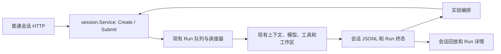

# MASS 测评模块技术方案

状态：待评审。本文描述首版方案，尚未实现。

## 1. 目标与范围

在空间内创建评测集，手动录入多条用例。每条用例包含一组有序的纯文本 User Prompt；一条是单轮，多条是在同一会话中连续发送的多轮。实验选择一个评测集、一个 Agent、一个明确的 Agent 发布版本和最大并发用例数。发起后由服务端执行，关闭页面不影响进度。

首版交付运行结果和回放：按用例看执行是否完成、失败位置、各轮原始对话及 Run 详情。执行成功表示所有轮次都按普通会话契约完成，不表示答案正确。评分、期望答案、批量导入、附件、调试快照和实验取消不纳入本次实现。重新执行时发起新实验，保留旧结果。

## 2. 复用普通会话链路

聊天页通过 `POST /api/v1/spaces/{space_id}/sessions` 创建会话，再通过 `POST /api/v1/spaces/{space_id}/sessions/{session_id}/runs` 发送消息。这两个 handler 已直接调用 [session.Service](../internal/app/session/service.go) 的 `Create` 和 `Submit`。实验在同一进程中复用这两个应用服务的实现，不经本机 HTTP，不保存登录 Cookie，也不构造模型请求或直接调用执行器。

每条实验用例创建一个空白会话，固定实验选择的 `version_id`，不继承其它会话或工作区。编排器按原文提交第 1 条 Prompt；等该 Run 完成既有收尾，且终态为 `succeeded`，再把第 2 条作为新的用户消息提交给同一会话。以此类推。上下文、工具、跨轮工作区和模型输出都由现有链路产生。编排器以已提交的 Run 终态及索引为推进条件，不消费 SSE，也不把流结束或出现最终文本视为可以续跑。某一轮失败、被取消或中断时，保留已产生的记录，停止该用例的后续轮次；其它用例继续。

一致性指相同版本、输入和运行环境走相同执行行为，不保证回复文本逐字相同。`Create` 固定 Agent 和 Skill 定义；`Submit` 仍按现有规则读取当前模型配置并检查权限，实际配置可从各轮 Run 追查。工具也按普通会话真实执行，具备写入能力的外部工具可能产生实际副作用。发起时检查 Agent 和版本属于同一空间、未归档且为发布版本；稍后新建用例会话时仍遵循现有归档检查。默认版本切换不会改变实验目标；若目标在排队期间归档，无法创建会话的用例记录实际错误，不切换版本。

## 3. 数据与接口

新增一份增量迁移，只创建两张测评表，不改动现有 `sessions`、`runs` 表结构或会话 JSONL 格式。回复、模型步骤、工具结果、产物、工作区快照仍由现有会话存储负责。

| 数据 | 保存内容和约束 |
| --- | --- |
| `evaluation_datasets` | `space_id`、`id`、整数 `version`、`name`、`saved_at` 和有序 `cases` JSON。每行是一份已冻结版本，以 `(space_id, id, version)` 为主键。同一评测集的 `id` 跨版本保持不变。用例包含可选名称和 `prompts: string[]`，该版本内按数组位置确定用例序号。 |
| `evaluation_experiments` | `id`、`space_id`、`actor_id`、`created_at`、`dataset_id`、`dataset_version`、`agent_id`、`agent_version_id`、`concurrency`、创建请求幂等键及摘要、可空的 `result` JSON 和 `completed_at`。`(space_id, dataset_id, dataset_version)` 引用同空间的一份冻结版本。实验不复制评测集名称、用例或 Prompt，也不持久化 `case_progress`。 |

评测集创建时插入 `version = 1`。之后每次保存都提交完整内容，由服务端在同一事务内为该评测集分配下一版本号并插入新行。分配版本号时用该评测集的首版记录串行化保存，避免重复编号；客户端不传版本，也不做编辑冲突检查。保存失败不产生新版本，已冻结的版本不会被覆盖。列表和编辑默认读取最大版本号，不另存当前版本指针。

创建实验时，用一个 MariaDB 事务确认调用人可访问空间、检查当前已保存版本非空，并在实验中记录该版本号。后续执行和回放始终按 `dataset_id` 和 `dataset_version` 读取已冻结的输入。以 `(space_id, actor_id, idempotency_key)` 作创建幂等，重复相同请求返回同一个实验，即使此后评测集已保存新版本；同键不同内容返回 `409`。Agent 目录在 TOS，发起时的 Agent 版本检查在数据库事务外进行，新建会话时由现有服务重新核对。

`case_progress` 只在进程内存中维护，按从 `1` 开始的用例序号索引。未认领的用例没有条目；认领后记录用例状态、建会话后返回的 `session_id`、按轮次排列的 `run_ids`，以及必要的 `failure_stage` 和 `failure_code`。一个用例结束且已有会话时，在该条目补齐六项会话指标。实验与会话的关联由测评侧保存，单轮状态和回复仍以原 Run 为准。

| 会话指标 | 统计口径 |
| --- | --- |
| `input_tokens` | 所有轮次的模型尝试中，供应商返回的 `prompt_tokens` 之和，含命中缓存的输入。 |
| `input_cached_tokens` | 供应商返回的 `prompt_tokens_details.cached_tokens` 之和，只统计命中缓存的输入。 |
| `output_tokens` | 供应商返回的 `completion_tokens` 之和，沿用供应商口径。 |
| `reasoning_tokens` | 供应商返回的 `completion_tokens_details.reasoning_tokens` 之和；单列展示，不再加到 `output_tokens`。 |
| `duration_ms` | 从建会话成功到用例结束的实际经过时间，包含 Run 排队、轮间等待及收尾，不包含创建会话和保存实验结果。 |
| `step_count` | 按 `(run_id, step)` 统计不同的模型步骤，包含摘要步骤；同一步内的重试不重复计步，工具调用不单独计步。 |

Token 汇总包含摘要和重试等模型尝试。只要有一次尝试没返回某项，该项汇总就记为 `null`；明确返回 `0` 时按 `0` 统计。确认没有模型尝试的会话，Token 和步骤记 `0`；没有建成会话的用例不产生会话指标。用例中途失败但已有会话时，只统计已实际执行的部分。现有 Trace 将缺失的明细项归零，实施时需在 Recorder 保留原始可空用量，且在 Run 确认收尾、Recorder 清理前，通过通用内部回调将用量和步骤摘要交给编排器。编排器在提交首轮前按会话订阅，以 Run ID 去重；回调不传对话正文，不改变现有 Trace 和 JSONL 格式。

实验全部用例结束后，将各用例的最终状态、会话与 Run 引用、错误和指标合并为 `result`，与 `completed_at` 一次写入。已完成实验从 `result` 回看，运行中的实验从内存读进度。模型回复和 Trace 仍不复制到实验表。

首版建议限制：单条 Prompt 沿用普通 Run 的规则，非空且最多 256 KiB UTF-8，不改变提交原文。每集最多 100 条用例，每条最多 10 轮，全部 Prompt 合计最多 2 MiB，允许先创建空集，发起实验时至少有一条用例。编辑和发起入口返回明确的限制错误。

API 均使用 `/api/v1/spaces/{space_id}/evaluation` 前缀，复用现有登录、写请求 Origin 校验和空间成员检查。

| API | 行为 |
| --- | --- |
| `GET /datasets`、`POST /datasets` | 列表返回元数据（含 `version`）和用例数；创建返回评测集 ID 和 `version: 1`。 |
| `GET /datasets/{id}`、`POST /datasets/{id}/versions` | 读取当前版本详情；提交名称和有序用例，新增冻结版本并返回新的 `version`。 |
| `POST /experiments` | 提交 `dataset_id`、`agent_id`、`agent_version_id`、`concurrency`、`idempotency_key`；服务端固定当前保存的评测集版本，写入元数据并将任务放入内存队列后返回 `202` 和实验 ID。 |
| `GET /experiments`、`GET /experiments/{id}` | 列表和详情，包括固定输入、状态、用例数和进度。 |
| `GET /experiments/{id}/cases`、`GET /experiments/{id}/cases/{ordinal}` | 分页查看用例状态；详情从冻结版本读取输入，按可用情况返回会话 ID、各轮 Run ID、失败位置和已结束会话的指标。回放走现有会话及 Run 查询。 |

## 4. 后台编排、并发和中断

新增 `internal/app/evaluation`，负责实验编排和最终结果保存。在 [StartRuntime](../internal/bootstrap/runtime.go) 中接入编排器，复用服务生命周期和运行租约。实验队列、用例认领、当前轮次和进度都在内存里，服务启动时不从数据库扫描或恢复实验。一个实验内的进度更新由编排器串行合并；页面只轮询，关闭页面不停止实验。

- **并发单位。** `concurrency` 限制同一实验的活跃用例数，一个用例从建会话到最后一轮收尾期间占一个名额；排队中的、执行中的和等待持久化收尾的用例都计入。同一用例最多有一个未终结 Run。建议默认 `1`，可填的上限取现有调度器的空间上限 `min(runtime.max_concurrent_runs, 2)`；同一空间所有实验共用这一活跃用例上限，避免同时发起多组实验就提交大量 Run。既有全局及空间 Run 配额仍由调度器执行，普通对话会竞争同一配额，实际同时执行数可能更低。调度规则不变。
- **提交与失败。** 建会话和发 Run 沿用现有幂等接口，返回的 ID 只写入内存。建会话或提交当前轮被拒绝时，记录失败阶段和错误码；已受理的 Run 失败时保留其 ID，由现有详情给出原错误码和快照结果。TOS 终态上传或索引提交未确认时，不推进下一轮。首版不恢复中断的实验，也不根据底层日志重建用例关联或进度。
- **查询状态。** 有已提交的最终结果为 `completed`，即使其中部分用例失败也算执行结束。有内存任务时按调度进度显示 `queued` 或 `running`。有实验元数据，但没有内存任务也没有最终结果时显示 `interrupted`，用例进度和指标不可用。进程退出或最终结果保存失败时允许丢失本次实验尚未保存的全部过程数据；重新执行需发起新实验。已经由普通会话服务写入的会话与 Run 仍由原运行时处理，测评不回滚或接管。

## 5. 权限和用户界面

空间成员可以维护本空间评测集、发起实验和查看历史。服务端用发起人的 `actor_id` 调用会话服务，遵循原有模型和工具权限；退出登录不等于撤销空间访问。发起人失去空间访问时，不再发新轮次，未执行用例以 `permission_revoked` 结束，已受理的 Run 由现有权限检查和收尾逻辑处理。编排器只可从已归属该用例的 Run 索引核对这些 Run 的终态，不能借此读取输出或替换发起人；其他仍有空间权限的成员可以看结果。所有详情按空间和父资源约束查询。

测评会话仍有真实 Session 和 Run ID。为防止普通用户在实验回填 `session_id` 前就能改写会话，内部创建使用公共 API 不接受的幂等键命名空间（例如 `~` 加不透明摘要）。通用会话入口只识别这个命名空间代表服务端管理的会话，不解析实验 ID 或用例序号。普通会话列表在分页前排除这类会话，公共写入口按会话拒绝手工续聊、附件上传、取消和工作区修改。实验页面以只读方式复用原消息、产物和 Trace 查询；编排器从自己的用例记录定位会话，继续使用相同的 `Create` / `Submit` 逻辑。公共 API 不增加测评归属字段。

空间导航新增「测评」，分为「评测集」和「实验」。评测集可添加、编辑、移除或重排用例与 Prompt；实验创建页按「评测集 → Agent → 发布版本 → 并发数」选择，显示用例及总轮数。实验详情展示各用例进度、失败轮次和运行记录，点击打开该用例的会话回放或指定 Run 详情。

## 6. 实施与验收

实施顺序：先加评测集版本、实验元数据和结果存储及空间 API；再接会话编排和指标汇总；最后接入页面、更新 OpenAPI 和生成的前端类型。备份沿用 MariaDB 导出和 TOS 会话对象复制；测评会话虽不出现在普通列表，仍须纳入基于 `sessions` 索引的备份还原。验证时覆盖从 schema 16 原地升级，并运行现有会话和 API 契约检查。

| 验收场景 | 可观察结果 |
| --- | --- |
| 用版本 `1` 发起实验后，删除或重排用例并保存版本 `2` | 两个版本各自保留原内容。旧实验即使尚未开始，也使用版本 `1` 的用例、顺序和 Prompt；新实验使用版本 `2`。保存失败不产生新版本。 |
| 用固定模型夹具分别在聊天和测评中运行同一 Agent 版本及多轮输入 | 两者经同一路径提交；测评第二轮看到同一会话的第一轮消息和已提交文件；另一用例看不到这些状态。 |
| 用例数大于并发数，同时发起两组实验 | 活跃用例数遵守实验及空间限制，Run 仍遵守原配额；同一用例始终串行，不同用例并行收尾时各自保留结果。 |
| 某轮失败，或终态上传暂时失败 | 失败用例不发送后续 Prompt，不阻止其它用例；暂未提交的终态不推进下一轮，也不重复发当前轮。 |
| 用模型夹具执行两轮，包含工具续跑、重试和缺失的 Token 明细 | 用例结束后有六项会话指标；Token 计入重试，步骤不重复计重试，未知和真实 `0` 可区分。最终结果与运行时汇总一致。 |
| 重复提交实验，并分别在运行中、结果已保存后重启 | 同键返回原实验。运行中重启后显示 `interrupted`，过程进度可以丢失，不自动继续或重跑；结果已保存的实验仍可回看。 |
| 检查隔离和普通会话回归 | `sessions` 表结构不变；跨空间及撤权请求被拒绝；不依赖内存用例记录也能阻止公共写入口改变测评会话或生成内部键；普通会话仍按原契约工作。 |
