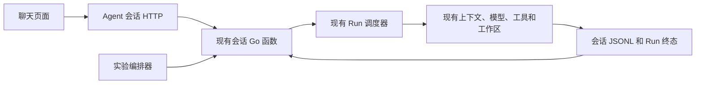

# MASS 测评模块技术方案

状态：首版已实现，验收依据见本文第 6 节。

## 1. 目标与范围

在空间内创建评测集，手动录入多条独立用例。`cases` 数组每个元素是一条用例，包含有序的 `turns` 数组；每个 turn 是一轮用户输入。每条用例创建一个独立 Session，依次提交各轮输入；`turns` 长度为 `1` 时就是单轮。输入结构和编辑表单为图片、视频预留位置，首版实际录入和执行文本，支持单轮及多轮对话。实验选择一个评测集、一个 Agent、一个明确的 Agent 发布版本和最大并发用例数。发起后由服务端执行，关闭页面不影响进度。

首版交付运行结果和回放：按用例看执行是否完成、失败轮次、原始对话及各轮 Run 详情。执行成功表示该用例所有轮次的 Run 都按普通会话契约完成，不表示答案正确。图片和视频本次只预留输入契约与表单位置，实际上传及多模态会话执行、评分、期望答案、批量导入、其它附件、调试快照和实验取消不纳入本次实现。重新执行时发起新实验，保留旧结果。

## 2. 通过 Go 函数复用普通会话

测评编排器通过聊天页现有的 Go 函数创建会话和提交 Run，传入已认证的实验发起人 `actor_id` 和空间，沿用原有的空间、模型和工具权限检查。后台通过归档运行时的只读入口跟踪已受理的 Run。启动层只向测评注入下表所需的调用入口，测评不直接访问会话索引、对象存储、Trace Recorder 或执行器。



| 现有 Go 函数 | 测评用途 |
| --- | --- |
| `catalog.Service.Draft`、`catalog.Service.Version` | 发起前确认 Agent 和所选发布版本未归档，且该版本属于该 Agent，`kind` 传 `agent`。 |
| `session.Service.Create` | 每个用例创建一个空白会话，传 `CreateInput`，包含 `AgentID`、显式 `VersionID`、幂等键 `Key` 和新增的通用展示选项 `Hide: true`，保存返回的会话 ID。 |
| `session.Service.Submit` | 从当前 turn 的 `content` 中唯一的文本内容项取得原文，提交 `SubmitInput.Text` 和该轮幂等键 `Key`，按轮次保存返回的 Run ID。 |
| `AcceptedRunStatus(ctx, space, sessionID, runID)` | 从当前进程的会话读取已受理 Run 的真实状态。确认收尾且状态为 `succeeded` 后，才向同一会话发送下一轮。 |
| `AcceptedRunDiagnostics(ctx, space, sessionID, runIDs)` | 用例结束后复用会话诊断读取逻辑，返回该会话中属于该用例的 Run 记录，供编排器汇总四项 Token、步骤数和耗时。 |

不同用例使用独立会话，不继承彼此的历史或工作区。同一用例的各轮在同一个 Session 中执行，历史、工具结果和跨轮工作区按现有会话规则延续。编排器以已受理 Run 的实际终态推进，不订阅 SSE；不把 Assistant 回复拼回用户输入，也不在后续轮次重发之前的 Prompt。某轮 Run 失败或被取消时，不再发送该用例后续 turn，保留已有记录并结束用例；其它用例继续。全部 turn 成功才将用例标为 `succeeded`。一轮内可以有多次模型和工具调用，仍只对应一个 Run。

一致性指相同版本、输入和运行环境走相同执行行为，不保证回复文本逐字相同。`Create` 固定 Agent 和 Skill 定义；`Submit` 仍按现有规则读取当前模型配置并检查权限，实际配置可从各用例的 Run 追查。工具也按普通会话真实执行，具备写入能力的外部工具可能产生实际副作用。发起时检查 Agent 和版本属于同一空间、未归档且为发布版本；稍后新建用例会话时仍遵循现有归档检查。默认版本切换不会改变实验目标；若目标在排队期间归档，无法创建会话的用例记录实际错误，不切换版本。

## 3. 数据与接口

新增一份增量迁移，创建两张测评表，并在现有 `sessions` 增加通用字段 `hide BOOLEAN NOT NULL DEFAULT FALSE`。`hide = true` 表示不在普通前端会话列表展示；旧会话和用户新建会话默认 `false`。`runs` 表结构和会话 JSONL 格式保持不变。回复、模型步骤、工具结果、产物、工作区快照仍由现有会话存储负责。

| 数据 | 保存内容和约束 |
| --- | --- |
| `evaluation_datasets` | `space_id`、`id`、整数 `version`、`name`、`saved_at` 和有序 `cases` JSON。每行是一份已冻结版本，以 `(space_id, id, version)` 为主键。同一评测集的 `id` 跨版本保持不变。每条用例包含 `turns` 数组，每轮包含 `content` 数组，使用有类型的内容项预留文本、图片和视频。用例序号和轮次由各自数组位置确定，均从 `1` 开始。 |
| `evaluation_experiments` | `id`、`space_id`、`actor_id`、`created_at`、`dataset_id`、`dataset_version`、`agent_id`、`agent_version_id`、`concurrency`、创建请求幂等键及摘要、可空的 `result` JSON 和 `completed_at`。`(space_id, dataset_id, dataset_version)` 引用同空间的一份冻结版本。实验不复制评测集名称、用例或 Prompt，过程中不逐步持久化 `case_progress`。 |

评测集创建时插入 `version = 1`。之后每次保存都提交完整内容，由服务端在同一事务内为该评测集分配下一版本号并插入新行。分配版本号时用该评测集的首版记录串行化保存，避免重复编号；客户端不传版本，也不做编辑冲突检查。保存失败不产生新版本，已冻结的版本不会被覆盖。列表和编辑默认读取最大版本号，不另存当前版本指针。

创建实验时，用一个 MariaDB 事务确认调用人可访问空间、检查当前已保存版本非空，并在实验中记录该版本号。后续执行和回放始终按 `dataset_id` 和 `dataset_version` 读取已冻结的输入。以 `(space_id, actor_id, idempotency_key)` 作创建幂等，重复相同请求返回同一个实验，即使此后评测集已保存新版本；同键不同内容返回 `409`。Agent 版本预检调用现有 Catalog 函数，在数据库事务外进行，新建会话时仍由 `session.Service.Create` 核对。

`case_progress` 只在进程内存中维护，按从 `1` 开始的用例序号索引。未认领的用例没有条目；认领后记录用例状态、建会话后返回的 `session_id`、按轮次排列的 `run_ids`，以及必要的 `failure_stage` 和 `failure_code`。一条用例共用一个 Session，每个已受理 turn 对应一个 Run。一个用例结束且已有会话时，在该条目记录整个会话的指标。实验与会话的关联由测评侧保存，运行状态和回复仍以原 Run 为准。

| 会话指标 | 统计口径 |
| --- | --- |
| `input_tokens` | 用例所有轮次 Run 的全部模型尝试中，供应商返回的 `prompt_tokens` 之和，含命中缓存的输入。 |
| `input_cached_tokens` | 供应商返回的 `prompt_tokens_details.cached_tokens` 之和，只统计命中缓存的输入。 |
| `output_tokens` | 供应商返回的 `completion_tokens` 之和，沿用供应商口径。 |
| `reasoning_tokens` | 供应商返回的 `completion_tokens_details.reasoning_tokens` 之和；单列展示，不再加到 `output_tokens`。 |
| `duration_ms` | 用最后一个已结束 Run 的 `run_finished.finished_at` 减去首个 Run 的 `run_accepted.accepted_at`，表示首轮受理到最后一轮进入收尾的时间跨度，包含排队和轮间间隔。它不代表最后一轮快照上传和终态提交全部完成的耗时，也不计建会话、诊断读取和保存实验结果。没有可配对的时间戳时耗时不可用。 |
| `step_count` | 按 `(run_id, step)` 统计不同的模型步骤，包含摘要步骤；同一步内的重试不重复计步，工具调用不单独计步。 |

用例结束后，编排器按该用例 `run_ids` 读取对应的诊断记录。四项 Token 从 `model_step.model.usage` 求和，含摘要和重试；整份用量或单项未上报都按 `0` 计入。没有模型尝试时 Token 和步骤均为 `0`；中途失败时只统计已提交终态的 Run。没有建成会话时不出会话指标。若诊断读取失败，保留已知的用例执行结果，无法计算的指标显示不可用。无需修改 Run 收尾、Trace 或 JSONL，也不新增公开会话接口。

实验全部用例结束后，将各用例的最终状态、会话与 Run 引用、错误和指标合并为 `result`，与 `completed_at` 一次写入。已完成实验从 `result` 回看，运行中的实验从内存读进度。模型回复和 Trace 仍不复制到实验表。

### 3.1 输入结构与媒体预留

`cases` 的完整 JSON 结构采用下面的对象数组，每个元素是一条独立用例，包含 `turns` 数组；每个 turn 包含有序的 `content` 数组。第一条用例有两轮，共用一个 Session 依次提交两个 Run；第二条用例只有一轮，创建另一个 Session 和一个 Run。所有 turn 都表示用户输入，不保存 Assistant 回复，也不增加 `role` 字段。内容项按 `type` 区分：

| 内容项 | 字段 | 含义 |
| --- | --- | --- |
| 文本 | `type: "text"`、`text: string` | 保存用户原文。首版每轮只接受一个文本内容项。 |
| 图片（预留） | `type: "image_url"`、`image_url: { "url": string }` | 保存图片地址。 |
| 视频（预留） | `type: "video_url"`、`video_url: { "url": string }` | 保存视频地址。 |

`content` 按原顺序保存文字和媒体 URL。完整文件字节不进入创建评测集的 JSON，请求体 `1 MiB` 上限继续适用。示例中的 `${image_url}`、`${video_url}` 代表实际地址，不引入模板变量或变量替换机制。

冻结版本固定内容项及其中的 URL 字符串；外部 URL 对应的文件是否变化、地址是否过期，由该媒体来源决定，评测集不自动下载或归档媒体。首版不增加媒体上传接口、表或占位对象，保存和发起入口对 `image_url`、`video_url` 内容项明确返回“暂不支持媒体输入”，不忽略它们或把地址当成文本发送。当前附件上传能力不等于模型已经支持图片或视频，后续实际接入应先扩展共用 Agent 会话链路，再由测评复用。

以下是已确认的完整 `cases` JSON 形状，其中图片、视频仍为预留类型，首版不接受此媒体输入示例：

```json
[
  {
    "turns": [
      {
        "content": [
          { "type": "text", "text": "请描述图片的内容。" },
          { "type": "image_url", "image_url": { "url": "${image_url}" } }
        ]
      },
      {
        "content": [
          { "type": "text", "text": "请用一句话概括刚才描述的内容。" }
        ]
      }
    ]
  },
  {
    "turns": [
      {
        "content": [
          { "type": "text", "text": "请描述视频的内容。" },
          { "type": "video_url", "video_url": { "url": "${video_url}" } }
        ]
      }
    ]
  }
]
```

### 3.2 过程与结果契约

直接沿用 `case_progress` 的结构，数据库的 `result` 就是该对象的最终值，不增加外层包装或另一套结果结构。每个键是冻结版本中的用例序号字符串，值的字段如下。

| 字段 | 类型及规则 |
| --- | --- |
| `status` | `active`、`succeeded`、`failed`。运行中尚未开始的用例没有条目，视为 `pending`；已保存的最终结果必须覆盖全部用例，且状态均已终结。 |
| `session_id` | 字符串，可省略。建会话成功后写入。 |
| `run_ids` | 字符串数组，初始为 `[]`，每轮被受理后追加 Run ID，`run_ids[i]` 对应 `turns[i]`，不插空位。长度不超过该用例轮数；用例成功时等于轮数。 |
| `failure_stage` | 仅失败时填写，值为 `create_session`、`submit_run` 或 `run`。 |
| `failure_code` | 仅失败时填写，来自调用错误或失败 Run 的原错误码；取消的 Run 使用原取消错误码。 |
| 四项 Token、`duration_ms`、`step_count` | 非负整数或 `null`。用例结束后写入六个字段；没有会话或诊断读取失败时均为 `null`。诊断成功且没有模型步骤时 Token 和步骤为 `0`，没有可配对时间戳时只有耗时为 `null`。供应商未上报的 Token 项按 `0`。 |

`failure_stage = submit_run` 的失败轮次为 `len(run_ids) + 1`；`failure_stage = run` 的失败轮次为 `len(run_ids)`，对应最后一个 Run；建会话失败时没有 Session，也不关联轮次。诊断读取失败不改写用例执行状态，不把指标读取错误当作模型执行失败。

以下用 ID 占位符展示最终对象：第 1 条用例两轮都成功，第 2 条用例第二轮的 Run 中途失败、后续轮次未执行，第 3 条用例未建成会话。

```json
{
  "1": {
    "status": "succeeded",
    "session_id": "SESSION_A",
    "run_ids": ["RUN_A1", "RUN_A2"],
    "input_tokens": 2400,
    "input_cached_tokens": 1200,
    "output_tokens": 500,
    "reasoning_tokens": 100,
    "duration_ms": 8000,
    "step_count": 3
  },
  "2": {
    "status": "failed",
    "session_id": "SESSION_B",
    "run_ids": ["RUN_B1", "RUN_B2"],
    "failure_stage": "run",
    "failure_code": "context_overflow",
    "input_tokens": 800,
    "input_cached_tokens": 0,
    "output_tokens": 100,
    "reasoning_tokens": 0,
    "duration_ms": 2000,
    "step_count": 1
  },
  "3": {
    "status": "failed",
    "run_ids": [],
    "failure_stage": "create_session",
    "failure_code": "invalid_definition",
    "input_tokens": null,
    "input_cached_tokens": null,
    "output_tokens": null,
    "reasoning_tokens": null,
    "duration_ms": null,
    "step_count": null
  }
}
```

首版限制：每条用例包含 `1–10` 个 turn，每轮必须有且仅有一个 `type: "text"` 内容项，其 `text` 沿用普通 Run 的规则，非空且最多 256 KiB UTF-8，不改变提交原文。每集最多 100 条独立用例；创建和保存版本的完整 JSON 请求体最多 `1 MiB`（`1 << 20` 字节），包含评测集名称、用例、轮次、内容项和 JSON 编码开销。允许先创建空集，发起实验时至少有一条用例。保存及发起前校验全部轮次，不在执行中忽略不支持的输入类型。

API 均使用 `/api/v1/spaces/{space_id}/evaluation` 前缀，复用现有登录、写请求 Origin 校验和空间成员检查。

| API | 行为 |
| --- | --- |
| `GET /datasets`、`POST /datasets` | 列表返回元数据（含 `version`）和用例数；创建返回评测集 ID 和 `version: 1`。 |
| `GET /datasets/{id}`、`POST /datasets/{id}/versions` | 读取当前版本详情；提交名称和有序用例，新增冻结版本并返回新的 `version`。 |
| `GET /datasets/{id}/versions/{version}` | 按明确版本读取名称及完整用例，用于查看实验采用的历史输入。 |
| `POST /experiments` | 提交 `dataset_id`、`agent_id`、`agent_version_id`、`concurrency`、`idempotency_key`；服务端固定当前保存的评测集版本，写入元数据并将任务放入内存队列后返回 `202` 和实验 ID。 |
| `GET /experiments`、`GET /experiments/{id}` | 列表和详情，包括固定输入、状态、用例数和进度。 |
| `GET /experiments/{id}/cases`、`GET /experiments/{id}/cases/{ordinal}` | 分页查看用例状态；详情从冻结版本读取全部 turn，按可用情况返回会话 ID、按轮次排列的 Run ID、失败轮次和已结束会话的指标。回放走现有会话及 Run 查询。 |

### 3.3 数据库与 API 实施示例

新增 ID 使用现有的 16 位短 ID；Agent 发布版本和用户 ID 沿用现有 UUID。时间使用 UTC 微秒。以下是拟落地的结构，不是已执行的迁移。

```sql
ALTER TABLE sessions
  ADD COLUMN hide BOOLEAN NOT NULL DEFAULT FALSE,
  ADD CONSTRAINT session_hide CHECK (hide IN (FALSE, TRUE)),
  ADD KEY visible_sessions (space_id, hide, id),
  DROP INDEX agent_sessions,
  ADD KEY agent_sessions (space_id, agent_id, hide, id);

CREATE TABLE evaluation_datasets (
  space_id CHAR(16) CHARACTER SET ascii COLLATE ascii_bin NOT NULL,
  id CHAR(16) CHARACTER SET ascii COLLATE ascii_bin NOT NULL,
  version BIGINT UNSIGNED NOT NULL,
  name VARCHAR(100) NOT NULL,
  saved_at DATETIME(6) NOT NULL,
  cases JSON NOT NULL,
  PRIMARY KEY (space_id, id, version),
  FOREIGN KEY (space_id) REFERENCES spaces(id),
  CHECK (id REGEXP '^[a-z2-7]{16}$'),
  CHECK (version >= 1)
) ENGINE=InnoDB DEFAULT CHARSET=utf8mb4;

CREATE TABLE evaluation_experiments (
  id CHAR(16) CHARACTER SET ascii COLLATE ascii_bin PRIMARY KEY,
  space_id CHAR(16) CHARACTER SET ascii COLLATE ascii_bin NOT NULL,
  actor_id CHAR(36) CHARACTER SET ascii COLLATE ascii_bin NOT NULL,
  created_at DATETIME(6) NOT NULL,
  dataset_id CHAR(16) CHARACTER SET ascii COLLATE ascii_bin NOT NULL,
  dataset_version BIGINT UNSIGNED NOT NULL,
  agent_id CHAR(16) CHARACTER SET ascii COLLATE ascii_bin NOT NULL,
  agent_version_id CHAR(36) CHARACTER SET ascii COLLATE ascii_bin NOT NULL,
  concurrency SMALLINT UNSIGNED NOT NULL,
  idempotency_key VARCHAR(128) CHARACTER SET ascii COLLATE ascii_bin NOT NULL,
  request_digest CHAR(64) CHARACTER SET ascii COLLATE ascii_bin NOT NULL,
  result JSON NULL,
  completed_at DATETIME(6) NULL,
  UNIQUE KEY experiment_request (space_id, actor_id, idempotency_key),
  KEY space_experiments (space_id, id),
  KEY experiment_dataset (space_id, dataset_id, dataset_version),
  FOREIGN KEY (space_id, dataset_id, dataset_version)
    REFERENCES evaluation_datasets(space_id, id, version),
  FOREIGN KEY (actor_id) REFERENCES users(id),
  CHECK (id REGEXP '^[a-z2-7]{16}$'),
  CHECK (concurrency >= 1),
  CHECK ((result IS NULL AND completed_at IS NULL) OR
         (result IS NOT NULL AND completed_at IS NOT NULL))
) ENGINE=InnoDB;
```

会话列表两个索引对应当前空间列表和 Agent 列表的过滤、排序；实验列表索引对应按空间分页。Agent 和版本存在于 TOS 目录，数据库不为它们添加不存在的外键。

假设某个评测集已保存 `v1` 和 `v2`，下次保存的事务步骤是：

1. 校验同空间访问权限，以 `SELECT ... WHERE space_id = ? AND id = ? AND version = 1 FOR UPDATE` 锁定该评测集的首版行。
2. 用当前读 `SELECT version ... WHERE space_id = ? AND id = ? ORDER BY version DESC LIMIT 1 FOR UPDATE` 取得 `2`，插入完整的 `v3`，旧行不更新。
3. 提交后返回 `version: 3`；事务失败则没有 `v3`。不存在的评测集 ID 返回 `404`。

创建实验时，先查创建请求幂等结果，再在同一事务视图中一次读取最新版本行及其内容，验证至少有一个用例，将所读 `version` 写入实验。若此时读到 `v2`，之后保存的 `v3` 不会改变本次实验。最终结果用一条更新语句同时写 `result` 和 `completed_at`，读取状态优先以这两项为准，数据库写完后才移除内存任务。

所有列表沿用现有签名游标与 `limit` 约定，默认 `20`，范围 `1–100`，按 ID 升序分页；评测集先聚合每个 ID 的最大版本再分页。用例列表按序号升序分页，返回 `next_cursor`。名称沿用 `1–100` 个字符和 UTF-8 校验。只有评测集创建 `POST /datasets` 和保存版本 `POST /datasets/{id}/versions` 使用现有的 `decodeCatalog(w, r, &body, 1 << 20)`，将完整请求体上限设为 `1 MiB`。其它接口沿用各自现有上限。

例如 `POST /datasets/{id}/versions` 提交下列完整内容，将得到新的冻结版本；`GET /datasets/{id}` 返回最新版本，`GET /datasets/{id}/versions/2` 则始终返回 `v2` 的输入。

```json
{
  "name": "单轮与多轮文本测试",
  "cases": [
    {
      "turns": [
        { "content": [{ "type": "text", "text": "记住项目代号是青鸟。" }] },
        { "content": [{ "type": "text", "text": "项目代号是什么？" }] }
      ]
    },
    {
      "turns": [
        { "content": [{ "type": "text", "text": "请解释什么是缓存。" }] }
      ]
    }
  ]
}
```

## 4. 后台编排、并发和中断

新增 `internal/app/evaluation`，负责实验编排和最终结果保存。在 [服务启动层](../internal/bootstrap/server.go) 装配编排器，注入既有会话 Go 函数。编排器随服务启停，不使用会话运行租约或调度器内部接口。实验队列、用例认领、会话与 Run 引用和进度都在内存里，服务启动时不从数据库扫描或恢复实验。一个实验内的进度更新由编排器串行合并；页面只轮询，关闭页面不停止实验。

- **并发单位。** `concurrency` 限制同一实验的活跃用例数，一个用例从建会话到全部轮次结束并完成指标读取期间占一个名额；排队中、执行中、轮间等待和持久化收尾的用例都计入。同一用例按 turn 顺序串行，同一时刻最多一个未终结 Run。发起页面默认 `1`，每场实验独立按所填并发数编排，实际活跃用例数最多为该评测集的用例总数。运行调度器继续按队列认领 Run，已认领的不同会话可并行执行。
- **提交与失败。** 建会话和发 Run 沿用既有 Go 函数的幂等语义，返回的 ID 只写入内存。建会话的稳定键由实验 ID 和用例序号派生，各轮提交的稳定键再加入 turn 序号，均符合现有键格式。提交结果不明时，只能用相同幂等键和该轮原文核对，不生成新键重发，也不发送下一轮。建会话或提交明确失败时记录阶段及错误码；已受理的 Run 失败时保留其 ID，以原错误码和快照结果为准，停止该用例后续 turn。首版不恢复中断的实验，也不从底层日志重建用例关联或进度。
- **查询状态。** 有已提交的最终结果为 `completed`，即使其中部分用例失败也算执行结束。有内存任务时按调度进度显示 `queued` 或 `running`。有实验元数据，但没有内存任务也没有最终结果时显示 `interrupted`，用例进度和指标不可用。进程退出或最终结果保存失败时允许丢失本次实验尚未保存的全部过程数据；重新执行需发起新实验。已经由普通会话服务写入的会话与 Run 仍由原运行时处理，测评不回滚或接管。

### 4.1 调用期限与退出规则

首版采用固定的实现默认值，不增加超时配置项：

| 操作 | 期限与处理 |
| --- | --- |
| Catalog、建会话、提交 Run、查询 Run、读取诊断、保存最终结果 | 每次独立调用设置 `15s` context 超时，由编排器生命周期派生，不复用发起实验的 HTTP 请求 context。 |
| 轮询 Run | 每 `1s` 查询一次，上一查询结束后再等待，不并发查询同一个 Run。 |
| Run 排队 | 从受理开始最多等待 `10min`；期间查询到执行状态后切换为运行等待期限。 |
| Run 执行与持久化收尾 | 从 `started_at` 起最多等待 `Definition.TimeoutSeconds + runtime.snapshot_timeout + 60s`。每次从查询结果取得实际运行限额；到期仍未得到终态时，不把它视为成功。 |
| 瞬时查询错误或提交结果不明 | 间隔 `1s` 核对，最多连续失败 `3` 次。建会话和提交 Run 只能使用相同幂等键与输入；业务校验、空间权限等明确拒绝不重试。 |
| 用例结束后读取诊断 | 只调用一次，失败则相关指标为 `null`，保留该用例实际执行结果。 |

排队、执行及收尾期限分别应用于每个 Run；一轮成功后，下一轮重新按自己的受理时间和 `started_at` 计算期限，不把整个多轮用例限制在一个 Run 的时限内。单次调用的 `15s` 期限不限制后台 Run 的实际执行时间。

出现 `runtime_unavailable`、排队/运行等待超时、连续三次仍无法确认会话或 Run 状态时，终止整场实验的编排：取消该实验的后台 context，停止认领和提交，等待其工作协程退出后释放测评名额。该实验不写最终 `result`，对外显示 `interrupted`，服务日志记录实验 ID 和中断原因。已经受理的 Run 仍由会话模块处理，不修改其终态，也不为超时自动重跑。

普通用例失败不终止整场实验。建会话或提交 Run 遇到撤权时，停止认领和新的提交，受阻的用例记录 `permission_revoked`。并行用例已受理的 Run 继续跟踪至真实终态并读取指标。最终结果写入只尝试一次；结果写入失败后停止任务。若写入实际已提交，以数据库里同时存在的 `result` 和 `completed_at` 为完成依据。

服务退出时先停止接收实验并取消测评后台任务，在现有 `http.shutdown_timeout` 预算内等待编排器退出，再关闭会话运行时和数据库。允许未完成实验的内存数据丢失，不通过停机流程恢复或续跑。

## 5. 权限和用户界面

空间成员可以维护本空间评测集、发起实验和查看历史。测评 HTTP 入口沿用现有登录和 Origin 检查，从已认证用户取得 `actor_id`。实验发起、为用例创建会话、提交每轮 Run 时校验发起人当前的空间成员资格。普通会话接口、Run 执行时的权限检查和用户查看实验结果时的权限检查沿用现有规则。

后台轮询和指标读取仅使用当前用例的 `Create`、`Submit` 返回的会话和 Run ID，校验空间、会话与 Run 的对应关系，不查询发起人的成员资格。撤权后遇到下一次受权限保护的写入时，编排器停止新的提交。已经受理的最后一轮若成功，保留实际成功结果。最终结果由后台按原发起人、空间和实验 ID 写入匹配的未完成记录，仍有空间访问权限的成员可以查看结果。

会话隐藏由通用 `hide` 字段控制。`CreateInput` 和会话详情返回值增加 `hide`，与已有请求内容一起参与幂等摘要；输入使用 `json:"hide,omitempty"`，让默认 `false` 时的摘要保持兼容，旧请求仍可按原幂等键核对。会话索引创建时一并写入，读取详情时从该索引读取展示属性，不依赖 JSONL 增加字段。普通建会话省略该选项，测评传 `true`。空间会话列表和 Agent 会话列表均在数据库分页前加 `hide = FALSE`；按 ID 读取会话、消息、产物和 Trace 仍沿用现有权限检查。

`hide` 只控制列表展示，不表达测评归属或写入权限；首版不增加特殊幂等键、公共写入口拦截或额外的只读会话协议。实验页面提供只读回放，编排器每个用例创建新会话并按顺序提交该用例的 turn。具备空间权限的调用方若持有隐藏会话 ID，仍可通过原会话接口操作它。

空间导航新增「测评」，分为「评测集」和「实验」。新建及编辑评测集可添加、编辑、移除或重排用例和其中的 turn；每轮保留文字编辑区和图片、视频输入位置，首版媒体控件禁用并标记“暂不支持”。单轮用例也统一保存一个 turn。实验创建页按「评测集 → Agent → 发布版本 → 并发数」选择，显示用例数和总轮数。实验详情展示每条用例已受理、已成功完成和总轮数、失败阶段与轮次，以及各轮运行记录；当前执行轮次和失败轮次由 `run_ids`、Run 状态及失败阶段推导，点击打开共用会话的回放或指定 Run 详情。

## 6. 实施与验收

实施顺序：先加评测集版本、实验元数据和结果存储及空间 API；再注入既有 Go 函数，接入会话编排和指标汇总；最后接入页面、更新 OpenAPI 和生成的前端类型。备份沿用 MariaDB 导出和 TOS 会话对象复制；测评会话虽不出现在普通列表，仍须纳入基于 `sessions` 索引的备份还原。验证时覆盖从 schema 16 原地升级，并运行现有会话和 API 契约检查。

| 验收场景 | 可观察结果 |
| --- | --- |
| 用版本 `1` 发起实验后，删除或重排用例及 turn 并保存版本 `2` | 两个版本各自保留原内容。旧实验即使尚未开始，也使用版本 `1` 的用例、轮次顺序和原文；新实验使用版本 `2`。保存失败不产生新版本。 |
| 创建或保存评测集，请求体超过 `16 KiB`，并检查 `1 MiB` 边界 | 满足用例及 Prompt 约束且请求体不超过 `1 MiB` 时保存成功；超过上限时拒绝，且不产生新版本。 |
| 检查单轮、多轮及图片视频预留 | 单轮 `turns` 长度为 `1`，多轮按顺序保存；每轮按 `content` 保存文本。任意一轮出现首版不支持的媒体类型时，保存或发起明确拒绝，不静默跳过。 |
| 用固定模型夹具分别在聊天和测评中运行同一 Agent 版本及多轮输入 | 聊天 HTTP handler 和测评调用同一会话 Go 函数；一条用例只有一个 Session，第二轮能看到第一轮历史和已提交文件；另一条用例创建独立 Session，历史及工作区互不继承。 |
| 用例数大于并发数，同时发起两组实验 | 两组实验分别遵守各自的并发用例数，同一空间可同时执行超过两条用例。同一用例始终串行并持续占用本实验的一个名额，不同用例并行收尾时各自保留结果。 |
| 用例第二轮 Run 失败，或第二轮终态上传暂时失败 | Run 失败则第三轮不提交，其它用例继续；终态未确认时不提前发第三轮、不重复发第二轮，超过等待期限则中断实验。 |
| 用模型夹具执行多轮任务，包含工具续跑、重试和缺失的 Token 明细 | `run_ids` 与轮次一一对应；六项指标汇总全部已执行轮次，可用共用会话的诊断返回值复算；Token 计入重试，未上报按 `0`，步骤按 `(run_id, step)` 去重。 |
| 分别模拟第三轮提交被拒绝、第二轮 Run 失败 | 前者从 `len(run_ids) + 1` 推出失败轮次 `3`，后者从 `len(run_ids)` 推出失败轮次 `2`，不需要新增失败轮次字段。 |
| 重复提交实验，并分别在运行中、结果已保存后重启 | 同键返回原实验。运行中重启后显示 `interrupted`，过程进度可以丢失，不自动继续或重跑；结果已保存的实验仍可回看。 |
| 实验运行中移除发起人的空间成员资格 | 已受理的 Run 仍可读取真实终态和指标。后续提交被拒绝的用例记录 `permission_revoked`，最后一轮已完成的用例保留实际结果。仍有空间访问权限的成员可以查看最终结果。 |
| 检查隐藏和普通会话回归 | 迁移后旧会话的 `hide` 为 `false`，仍正常展示；测评会话为 `true`，在分页前排除，不进入普通列表但可从实验回放；跨空间访问被拒绝，隐藏不影响原有按 ID 访问权限。 |
| 模拟运行时停止、Run 长期排队或终态提交持续失败 | 到达上述期限后实验显示 `interrupted`，无用例重复提交，编排工作协程退出并释放测评名额，底层 Run 状态未被改写。 |
